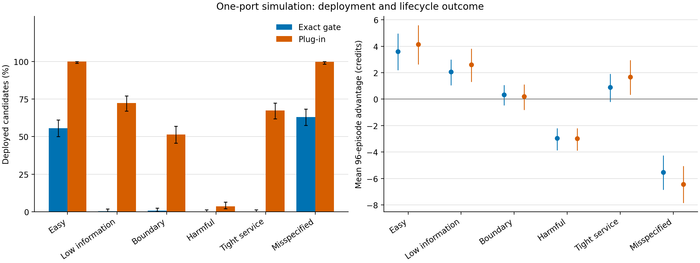
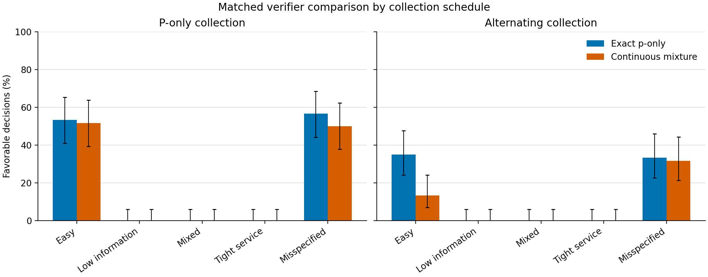
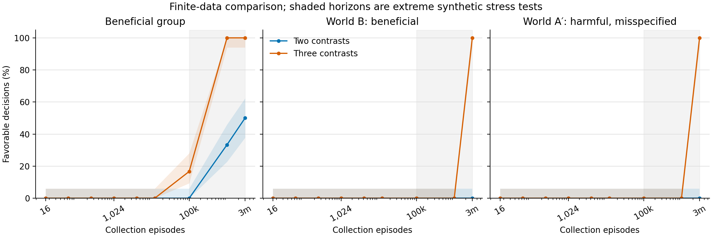
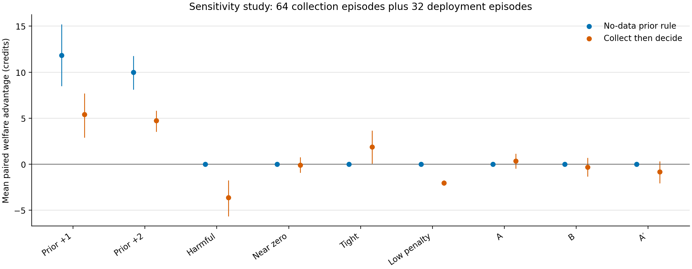

# Identifiability and Safe Comparison from Charging-Offer Feedback: A Simulation Study

**Working manuscript; not submission-ready.** The exploratory study and an independent data audit are complete, but the broad baseline comparison and external peer review remain incomplete. Author names, contributions, funding, conflicts and the target venue require the authors' factual input; none is invented here.

## Abstract

A charging controller may infer preferences from offers, but accepting an offer can reserve capacity and suppress later options. We study when binary responses support a favorable same-model welfare comparison under a shared expected-service limit. In a one-port model, we derive a conservative sequential decision rule and a sharp population welfare set when an unknown common response bias is allowed. Two worlds can produce identical observable histories while having opposite welfare rankings. A hypothetical third contrast restores population identification under the common-bias model, but its finite-data and service costs remain separate questions. Six independently seeded, prospectively frozen simulation studies compare decision rules in paired simulations; applicable gates share observed data within a collection schedule. In the first, a one-dimensional gate certified 167 of 300 easy cases and one of 300 low-information beneficial cases; it falsely certified 189 of 300 harmful cases under a shifted response law. A capped two-contrast verifier did not resolve the low-information group and also made false declarations under misspecification. Finally, bias-robust two- and three-contrast Hoeffding gates certified nobody at the evaluated checkpoints through 12,288 collection episodes in six groups. At an extreme three-million-episode checkpoint, the third contrast certified all 60 beneficial cases in an illustrative world but also all 60 harmful cases with a contrast-specific response shift. A fourth study varies known costs and urgent-arrival rates: in two prior-positive scenarios a no-data rule certified all 60 cases immediately, whereas both data rules certified none at 64 episodes. A fifth study models two persistent drivers sharing one port: at 64 collection resets, the prior-only rule certifies 60/60 in a prior-positive group while both data gates certify none; under a contrast-specific shift, the three-contrast natural schedule falsely certifies 3/60 at three million resets. A sixth fresh-sample study adds a theta-projection comparator: it certifies 21/60 prior-positive pairs at 64 resets versus 0/60 for the original three-contrast rule, while the no-data rule certifies 60/60 immediately. Under a deliberate contrast-specific shift, it falsely certifies 60/60 at the extreme checkpoint. The extreme checkpoint represents about 514 years of continuous toy-model use. The guarantees are model-conditional and per modeled driver or pair, as specified; the results do not establish practical charging performance, a new general inference method, or an RL improvement.

**Keywords:** electric-vehicle charging; preference learning; sequential testing; service constraints; simulation; policy comparison.

## 摘要

充電提議獲接受後會占用時段並改變後續可行選項。本研究以單一充電埠模擬，探討二元選擇何時能支持共同服務限制下的福利策略比較。我們推導具有共同回應偏移時的精確福利識別集合，並構造觀察歷程相同但福利排序相反的兩種模型。假設共同偏移成立時，第三種提議可恢復母體參數識別；其有限資料與服務成本仍須分別評估。六項預先固定的模擬顯示，保守方法在資訊不足時經常不判定，行為模型錯置亦可能導致錯誤有利判定。在第三項比較中，兩種方法在一萬二千二百八十八次收集以內的各預設檢查時點均未判定；極端三百萬次情境下，三提議方法對六十個有利案例與六十個偏移錯置的有害案例均作出有利判定。第四項比較中，已知條件可直接證明有利的兩組均由無資料方法立即判定，資料方法在六十四次收集時均未判定。第五項以兩名模擬駕駛者共用單一充電埠，於行為偏移錯置的極端情境中出現三個錯誤判定；第六項的參數投影比較在該極端錯置情境下對六十個案例均作出錯誤有利判定。極端情境相當於約五百一十四年連續使用，並非實務建議。所得保證依賴模型，適用個別模擬駕駛者或其配對，不能推論真實場域成效。

**關鍵詞：** 電動車充電、偏好學習、序貫檢定、服務限制、模擬、策略比較。

## 1. Introduction

A charging operator must allocate scarce charging slots while responding to heterogeneous user preferences. In a menu-based interaction, the user may accept a proposed delay or retain a default; an accepted reservation can limit later choices. Preference learning and charging decisions therefore interact through both information and capacity. The existence of a numerical utility model does not mean that a driver reveals utility values to the controller.

Online menu-based scheduling with capacity and binding completion commitments has already been studied by Mathioudaki et al. [1], and menu-based charging decisions with acceptance and welfare objectives by Ghosh and Aggarwal [2]. Shafipour et al. [3] learn preferences from sequential charging-route choices. Preference-based policy learning from hidden rewards [4], safe data collection for policy comparison [5], likelihood-based anytime inference [6] and parameter synthesis [7] are also established. Kim et al. [9] analyze reward identification under a different inverse-RL model, and Skalse and Abate [8] analyze partial reward identifiability and behavioral misspecification in inverse reinforcement learning; our construction specializes the issue to operational charging choices rather than introducing the general principle. The question here is narrower: for a specified charging model and fixed candidate/default pair, can operational binary choices provide an anytime-valid *sufficient* certificate of positive expected policy advantage while a common expected-service requirement is met?

Schnitzer, Abate and Parker [12] also project transition confidence intervals through shared parametric MDP structure and give sound rectangular and polyhedral relaxations, with a PRISM implementation and expected-reward as well as reachability benchmarks. Thus shared-parameter uncertainty projection and robust verification are not new contributions here. Our narrower question concerns a specified charging-offer channel, a hidden welfare coefficient linked to choice responses, conditional suppression of later offers, and how that comparison fails when the choice–welfare link is misspecified. A direct matched comparison with [12] has not been implemented: our sigmoid/logit constraints, unbounded common shifts and parameter-dependent welfare require a sound encoding or relaxation, and any anytime comparison needs an appropriate sequential confidence calibration. These differences establish the questions studied here, not priority over the literature.

The following comparison describes each source's stated setting and objective; it does not assert that a brief abstract check exhausts the full literature or proves the absence of an equivalent theorem.

| Closest work | Stated focus | Specific question in this paper |
|---|---|---|
| Charging menus [1, 2] | Online user choices, charging schedules or contracts, and capacity or welfare objectives | Can operational choices certify a particular same-model welfare comparison under an expected urgent-service allowance? |
| Online charging preferences [3] | Learning heterogeneous preferences from repeated route choices | How do choices that reserve a specific shared port affect a later offer and a policy-comparison certificate? |
| Preference-based RL [4] | Policy identification from trajectory-preference queries under specified reward/preference assumptions | What can a fixed two-offer charging feedback channel identify when the choice–welfare link is altered? |
| Safe policy comparison [5] | Safe collection for bandit policy evaluation and comparison | How does a modeled binary charging response support a hidden-welfare comparison and collection-service accounting? |
| Anytime likelihood inference [6] | General likelihood-ratio confidence methods | What does an exact conservative sufficient test establish for this charging instance? |
| Parametric verification [7, 12] | Region analysis and confidence-aware shared-parameter learning for parametric Markov models | How does the particular nonlinear choice model identify a hidden-welfare comparison under commitment-dependent exposure? |
| Reward identifiability [8, 9] | Reward ambiguity and behavioral-model assumptions in inverse reinforcement learning | What explicit observationally equivalent pair illustrates that issue for this one-port charging process? |

We contribute an explicit one-port construction with choice-dependent availability, an exact one-sided decision rule derived from its structural assumptions, a sharp population welfare set and observational-equivalence limitation for a broader choice model, and six frozen computational comparisons that expose both decisiveness and errors, including two-driver shared-port settings and an independently coded theta-projection comparator. The rule is not a new general inference technique. Its theoretical validity is conditional on the specified response law, persistent latent parameter and procurement/service model; its empirical usefulness is a separate question. We do not claim improved RL performance or generalized real-world welfare.

## 2. Model and decision target

Consider one 2 kW port over three half-hour slots. Two vehicles of one persistent modeled driver require 1 kWh each. Their default slots are 0 and 1; alternative slot 2 delays the first completion by one hour and the second by half an hour. The first alternative is offered first; if accepted it occupies slot 2 and prevents offering that slot to the second vehicle. If it is rejected, the second alternative may be offered. Every commitment and fallback is feasible. A unit urgent request arrives in slot 2 independently with probability δ=1/200 and incurs a penalty of 20 credits if the slot is occupied. Its delay coefficient is zero. The procurement costs are (0.568, 0.548, 0.4) credits/kWh. Retail prices (0.5, 0.5, 0.4) enter the response contrasts and cancel in the equal-weight operator–driver system ledger.

Let theta in [0,1/4] be the driver's delay coefficient and tau in [1/20,2/5] a response temperature. Both remain fixed across reset episodes. Given the full earlier history and a feasible offer, independent response innovations follow

    p = sigmoid((1/10 - theta)/tau),
    r = sigmoid((1/10 - theta/2)/tau).

The baseline uses both default slots. The candidate offers the first alternative and, only after rejection, the second. Accounting for the urgent penalty and avoided procurement of an unmet urgent request gives the same-model expected candidate advantage and urgent unmet energy

    B(theta,tau) = p(7/100 - theta) + (1-p) r(1/20 - theta/2),
    U(theta,tau) = (1/200) [p + (1-p)r].

The baseline has zero expected urgent shortfall. Thus both policies satisfy a per-episode allowance epsilon=1/200 under the full parameter domain. This is an expected quantity, not a pathwise guarantee: an accepted reservation can still cause an individual urgent request to be unmet. The structural relationship between choice and welfare is assumed; it is not identified nonparametrically from binary choices alone. Absolute software loss values omit the common default focal delay, while paired loss differences equal the corresponding full-ledger differences.

## 3. Sequential favorable-decision rule

A collection episode chooses either p or r using only earlier public history. A p episode offers the first alternative and defaults the second request; an r episode defaults the first and offers the second. All commitments expire before the next episode. Each collection episode has expected unmet at most 1/200, so H episodes have expected cumulative unmet at most H/200; this collection allowance is separate from deployment service.

The test adapts standard likelihood-ratio martingale reasoning [6]; only p responses enter this certificate. After s acceptances and f rejections of p offers, let

    L_A = (22/25)^s (3/25)^f,
    L_0 = sup_{0 <= q <= 2/3} q^s (1-q)^f.

The maximum uses q=min(s/(s+f),2/3) when s+f>0, with the empty likelihood equal to one. Set alpha=1/20 before observing responses. The controller latches a favorable decision at the first prefix for which alpha L_A>L_0, provided the service allowance is at least 1/200. These likelihoods are calculated as exact rational numbers. Otherwise it abstains from deploying the candidate and uses the default policy for deployment. In this comparison, all collectors continue through their shared 64-episode collection budget even after a crossing.

**Proposition.** Under the specified model and predictable p-offer selection, for each fixed driver, the probability that the rule ever declares a favorable comparison when B<=0 is at most alpha. For an allowance epsilon at least 1/200, both evaluated policies satisfy it under the model; if epsilon is smaller, this sufficient gate abstains.

**Proof.** For any true 0<p<=2/3 (the declared logistic domain has p>0), the fixed-alternative likelihood ratio L_A/L_p is a nonnegative martingale under the conditional Bernoulli law, including predictable skipping of p offers. Since L_0>=L_p pathwise, alpha L_A>L_0 implies L_A/L_p>1/alpha. Ville's inequality bounds the probability of any such crossing by alpha. In the stated parameter domain, p>2/3 implies theta<1/15: otherwise the first logit is at most 2/3, which is below log(2). For theta<1/15, both conditional benefit increments are positive, r>1/2, and p<=sigmoid(2)<121/137. Thus B>p/300+(1-p)/120=1/300+(1-p)/200>161/41100. Hence B<=0 implies p<=2/3, and any false favorable declaration is contained in the preceding crossing event. Finally U<=1/200 uniformly over the domain. ∎

The test is sufficient, not necessary. For example, theta=0 and tau=0.4 yields B>0 but p<2/3, so its probability of ever passing the gate is at most alpha. A fixed alternative also limits power for some p>2/3. The bound is across repeated histories at each fixed correctly specified driver, not a probability of truth conditional on the realized data; it is not a simultaneous familywise guarantee for an unadjusted collection of drivers. r observations do not improve this gate. Expected unmet under model misspecification still respects the deterministic one-port bound, but the benefit-error guarantee may fail.

### 3.1. A choice-only identification limit

The response-to-welfare link is load-bearing. As a post-run analytical construction, consider world A with theta=2/25, tau=1/5 and an additive 1/5 shift to both response logits, while normative welfare still uses theta. World B has theta=2/35, tau=1/7 and no shift. Their p and r logits are exactly 3/10 and 1/2, respectively. Both worlds therefore have the same probabilities p and r, identical feasible actions and physical-event kernels, and the same expected urgent unmet, approximately 0.004197, below 1/200.

Their policy rankings differ. In A, B_A=[(1-p)r-p]/100<0 because p>1/2 and r<1. In B, the two benefit increments are 9/700 and 3/140, so B_B>0. Numerically the respective advantages are approximately −0.003096 and +0.013062 credits.

**Proposition.** Suppose a controller observes only offers, responses, assignments, occupancy and urgent events, and uses world-independent internal randomness. For any adaptive collection and stopping rule, the probability of ever declaring the candidate favorable is identical in A and B. Hence any rule whose false-favorable probability is at most alpha in A has power at most alpha in B.

**Proof.** The initial observable state and randomization have the same distribution. If the observable histories agree in distribution through a given time, the controller selects the same distribution of feasible next actions in both worlds. Their conditional response and physical-transition distributions agree for each action, so the next histories also agree in distribution. Induction yields equality for every finite-time declaration event; taking the increasing union over finite times gives equality for an eventual declaration. The two benefit signs give the stated error–power implication. ∎

In this pair p=sigmoid(3/10)<2/3 in both worlds, so the one-dimensional p-null guarantee remains applicable; this particular pair does not produce the separate simulation's 63% misspecification failure. This is a limitation of the declared model class, not a universal impossibility: A permits a response shift that does not affect the stipulated welfare coefficient. Observable welfare, a justified restriction excluding that shift, or sufficiently informative new price contrasts may break equivalence. For example, if feasible and governed by the same response laws, a one-hour-delay offer with savings 1/5 has logits 4/5 and 1 in the two worlds; its response distributions differ, although a single response does not identify the world and the offer’s safety has not been established. Nor is observational equivalence claimed as a new general statistical principle. Under the further assumption that the finite shift c is common to all three contrasts and their exact population probabilities lie in (0,1), this third contrast identifies the entire parameter triple. For li=logit(qi) and lambda=1/tau, the designs (x,d)=(1/10,1), (1/10,1/2), (1/5,1) give lambda=10(l3−l1), theta=2(l2−l1)/lambda and c=l1−lambda(1/10−theta). These formulas require lambda>0 and parameters within the declared domain. They follow from full-rank linear inversion, not a new general identification principle. They do not establish finite-data precision, actual feasibility, safety, or robustness to contrast-dependent shifts; three logits also provide no spare unconstrained fit degrees of freedom for three coefficients, though domain restrictions can be tested. The full construction appears in `IDENTIFICATION_LIMIT.md`.

### 3.2. Sharp two-contrast welfare set under a common shift

The preceding pair is part of a broader post-run characterization. Suppose p,r∈(0,1) are exact population probabilities, c is an unrestricted finite common logit shift, and theta∈[0,1/4], tau∈[1/20,2/5]. Let k=2[logit(r)−logit(p)]=theta/tau. The model is compatible with the two probabilities exactly when 0≤k≤5. For compatible observations, the sharp theta set is

    theta ∈ [k/20, min(2k/5,1/4)].

Indeed, lambda=1/tau ranges over [max(5/2,4k),20], theta=k/lambda, and c can be chosen to match the first logit; the logit difference then matches the second. Conversely, every compatible parameter must obey these bounds. For k=0 the set is {0}.

Let A=(7/100)p+(1/20)(1−p)r and D=p+(1−p)r/2>0. Since B=A−D theta, its sharp identified set is

    [A−D min(2k/5,1/4), A−D k/20].

Expected urgent unmet U=[p+(1−p)r]/200 is identified from the two probabilities under the fixed physical model. In the constructed pair k=2/5, theta∈[0.02,0.16], and B ranges approximately from −0.059647 to +0.039318. This is a population set, not a finite-sample confidence interval. Bounding c can narrow it; allowing contrast-specific shifts changes the model. The result specializes standard partial-identification reasoning [8, 9] to this charging ledger.

### 3.3. A two-world information illustration for the extra contrast

Suppose the third contrast is feasible and has stationary conditional response probabilities q_A=sigmoid(4/5) and q_B=sigmoid(1) in the two constructed worlds. Other observable kernels agree, welfare remains hidden, and a common adapted policy uses an almost-surely finite stopped observable transcript. Let N3 count third-offer observations and D denote a favorable declaration. If P_A(D)≤alpha and P_B(D)≥1−beta for alpha<1−beta, the standard sequential change-of-measure argument [10] implies

    E_A[N3] kl(q_A || q_B) ≥ kl(alpha || 1−beta),

provided E_A[N3] is finite. At alpha=0.05 and beta=0.2, this gives E_A[N3]≥322.027745…; any fixed cap on the number of third-offer observations must be at least 323. This is an expectation under A, not a pathwise bound. A different, sufficient fixed-sample midpoint test between these two *known* Bernoulli models has each error at most exp[−n(q_B−q_A)^2/2] by Hoeffding’s inequality [11], so n=3550 suffices for each error to be at most 0.05. The two calculations target 80% and 95% power respectively and are not matching optimality bounds.

These post-run calculations do not establish that the hypothetical offer is available or safe, that its response law is correct, or that a practical controller knows the two worlds. The fixed-n guarantee is not automatically anytime-valid. Neither 64-episode simulation evaluated this hypothetical test.

### 3.4. Finite-data comparison under an unknown common shift

For each contrast j and its n observed binary responses, let the empirical mean be q-hat_j(n). Allocate alpha_j=1/60 and use the two-sided radius

    h(n) = sqrt[log(120 n(n+1))/(2n)].

Hoeffding's inequality [11] bounds failure at count n by 1/[60 n(n+1)]. Summing the telescoping weights over n and over three contrasts gives a single event of probability at least 19/20 on which all three probability bands cover their fixed conditional means at every count. With predictable offers and fresh conditional Bernoulli innovations, this remains valid at adaptive stopping times. A two-contrast gate uses only the first two bands; a three-contrast gate uses all three. Because both derive outer welfare and service bounds from the same three-band event, this event controls false favorable declarations for both jointly for each correctly modeled driver. The simpler two-band union bound alone is 2/60. None of these statements gives familywise control across drivers or conditional confidence after a favorable decision.

The two-contrast gate propagates the first two logit bands through the sharp theta set in Section 3.2. The three-contrast gate uses the third band to bound lambda and theta via Section 3.1. Both use outward Decimal interval operations, conservative corner extrema for welfare, an upper service bound and a verified central feasible witness; missing information, noninterior bands, unresolved arithmetic or an insufficient bound lead to abstention. Their interval primitives are shared, not independent numerical implementations. If the common shift differs by contrast, the three-contrast model-to-welfare inference can fail even when the Bernoulli bands themselves cover the actual probabilities.

### 3.5. Known variable physical inputs and a no-data baseline

The fixed physical calculation extends to known nonnegative procurement costs g0,g1,g2, urgent-arrival probability delta∈[0,1] and shortfall penalty W. Define a=g0−g2−delta(W−g2) and b=g1−g2−delta(W−g2). The same one-port process gives

    B=p(a−theta)+(1−p)r(b−theta/2),
    U=delta[p+(1−p)r].

The urgent penalty replaces the avoided urgent procurement in a blocked branch; procurement, delay and retail transfers retain the stated accounting boundary. Since B is nonincreasing in theta and bilinear in p,r at fixed theta, conservative lower and upper bounds evaluate all four probability corners at the upper and lower theta bounds, respectively, regardless of the signs of a and b. The service upper bound uses the upper p and r endpoints. The generalized gates reuse the confidence bands, witness and shared interval primitives in Section 3.4.

A sufficient no-data rule certifies when a≥1/4, b≥1/8, at least one inequality is strict, and epsilon≥delta. For every theta∈[0,1/4], both conditional welfare increments are nonnegative and at least one is strictly positive; finite logits ensure p and (1−p)r are positive. Thus B>0 pointwise and U≤delta≤epsilon. With an unrestricted common shift, no strictly positive uniform benefit margin is claimed. This rule can remain valid for finite contrast-specific response shifts because its physical inequality does not infer theta from choices.

### 3.6. Two distinct modeled drivers on one port

Let A default in slot 0 and B in slot 1, each with its own fixed delay parameter and choice shift. The candidate offers A slot 2 and offers B slot 2 only after A rejects. If p_A is A's first-offer probability and r_B is B's second-offer probability conditional on reach, then

    B_AB=p_A(a−theta_A)+(1−p_A)r_B(b−theta_B/2),
    U_AB=delta[p_A+(1−p_A)r_B].

This is aggregate system advantage and expected urgent unmet, not an individual fairness statement. It assumes B has a fresh Bernoulli response conditional on the complete pre-offer history and independent urgent arrivals. With driver-specific parameter sets, rectangular upper theta bounds and four p_A/r_B corners give a conservative gain lower bound; the upper endpoints give a service upper bound. The no-data sufficient condition in Section 3.5 also applies, using the separate theta bounds. Per-contrast Hoeffding bands allocate alpha/6=1/120 to each of six driver/contrast streams. Their union bound gives a shared 95% event for both data rules within a single fixed collection schedule for one modeled pair. No simultaneous 95% statement is made across the two schedules or across independently simulated pairs. Shared Decimal primitives are used for the numerical calculations.

### 3.7. Exploratory theta-projection comparison

A separate comparator uses the same two-driver probability bands and common-shift model but tightens each driver's admissible delay parameter through a bounded rational polygon. Set lambda=1/tau, v=theta/tau and h=logit(p). The p, r and third logits are h, h+v/2 and h+lambda/10; the prior is 2.5≤lambda≤20 and 0≤v≤lambda/4. Outward logit bands yield affine constraints. Eliminating the unrestricted h by pairing every finite lower and upper bound gives a bounded polygon in (lambda,v); exact rational vertex enumeration bounds theta=v/lambda, since lambda is strictly positive. A finite original-band witness is checked separately. The output is conservative because logit intervals are outward and the welfare calculation retains the original p/r boxes; it is not a full projection of all response expressions or the published PRISM method [12].

For three contrasts, this rule and both earlier rules use the same six-stream confidence event within a fixed schedule. Under the stated model, each favorable decision is sound on that event, so jointly assessing the three rules on the same bands does not require another split merely for the number of rules. Different schedules and pairs still require separate error accounting. The implementation shares directed interval primitives with the earlier gates and does not itself emit an independent proof tree or enforce a per-call resource cap.

## 4. Simulation design

The protocol in `PROTOCOL.md` declared before the run six independent synthetic population groups, 300 persistent drivers per group, a 64-episode information-collection horizon and 32 subsequent deployment episodes. Groups cover easy, low-information positive, boundary, harmful, tighter service and response-law misspecification. The latter adds a fixed shift to the actual response logits but does not alter the controller's nominal likelihood; it is reported separately, without nominal coverage claims.

Four collectors share the same opportunity and episode budgets: p-only, alternating p/r, posterior sign-entropy reduction and posterior expected one-step benefit. Posterior computations use a fixed grid and public responses. On each collected dataset the exact gate and a plug-in posterior decision are both assessed; a default lifecycle reference and a known-model deployment-only oracle are included. The oracle is not deployable and is not a full-lifecycle upper bound. Matched independent response and urgent-arrival innovations are reused only for the same driver, episode and event across arms; p and r innovations are distinct. Outcomes include certificate/deployment rates, false declarations, abstention, collection and deployment service, collection-inclusive lifecycle advantage, and paired uncertainty across independent drivers. The simulator uses floating-point sigmoid evaluations and pseudorandom uniforms as numerical approximations to the ideal response law; the exact mathematical probability bound is not a separate finite-bit guarantee for that implementation. The study is conditional on the specified synthetic model and is not a simulation of a multi-station or heterogeneous multi-driver queue.

### 4.1. Finite-data common-bias study

A third prospective protocol fixed fresh seeds and six groups of 60 synthetic drivers: beneficial, harmful, fixed A, fixed B, tight service, and A-prime. A-prime has A's physical welfare coefficient but an additional shift only on the third response, so its three response probabilities match B's while its true policy advantage is negative. Both gates receive the same periodic p/r/third collection data; the two-contrast gate ignores third labels. The third collection-only offer uses the same one-hour-delayed first-request reservation with a modeled retail price of 0.3 rather than the default 0.5; the candidate and default deployment tariffs remain unchanged. Decisions are checked only at prespecified horizons 16 through 12,288 episodes and three explicitly extreme synthetic stress horizons of 100,000, one million and three million episodes. Collection continues through each horizon; 32 separately keyed paired deployment episodes are evaluated for each horizon.

Under fixed periodic scheduling and independent per-episode response and urgency, a block with m offers and response probability q can be represented by K~Binomial(m,q), U|K~Binomial(K,1/200) and V|K~Binomial(m−K,1/200). K is the observed acceptance count, U blocked urgent arrivals and V served urgent arrivals. The recorded block totals preserve the specified gate inputs and paired additive service/welfare totals at checkpoints, but not within-block event order or stopping. A separate exact small-case enumeration checked this identity and physical ledger. The simulation uses numerical pseudorandom draws, not exact real Bernoulli sampling; source, protocol and outputs are independently hash-checked. Deployment epsilon is separate from the collection allowance H/200.

### 4.2. Variable-physics sensitivity study

A fourth prospective protocol fixed fresh seeds and nine groups of 60 synthetic drivers, varying known procurement, urgent-arrival probability, penalty and service allowance. It included two scenarios where the no-data sufficient rule applies, a harmful scenario, a deliberately selected near-zero-benefit stratum, a tighter service allowance, a W<g2 stress case, and fixed A/B/A-prime response worlds. The near-zero group is conditional on simulated true benefit and is not an unconditional population sample. W<g2 can make the stipulated welfare ledger reward unmet demand, so that group is a sign-sensitive mathematical stress case and service is examined separately.

The two and three data gates use the same periodic p/r/third histories and shared confidence bands. In each block, a common first-request uniform couples potential p and third acceptances; an independent second-response bit and urgent bit yield twelve mutually exclusive categories. Their multinomial counts preserve the selected feedback and paired additive costs at fixed checkpoints. Unoffered potential outcomes remain evaluator-only. Independent exact small-path enumeration checked the category distribution, commitments, retail-transfer cancellation and cost accounting against the variable-physics simulator.

All rules are compared against the same always-default H+32 calendar. The no-data rule uses candidate throughout when it certifies and default otherwise; the data rules collect for H and use their latched deployment decision for 32 additional episodes. A separately labeled counterfactual switches to candidate after the first certification checkpoint and accounts for the remaining calendar. Collection's H delta expected-unmet allowance is separate from deployment epsilon. The final three horizons, up to three million collection episodes, are explicitly non-operational synthetic stress tests.

### 4.3. Two-driver shared-port study

A fifth prospective protocol fixed seven groups of 60 independent synthetic driver pairs and a six-reset exogenous AB/BA calendar. In the natural schedule, one AB reset offers A its first contrast, then offers B its second contrast only if A rejects; no B label is recorded otherwise. The forced schedule changes that reset to default A and offer B directly. Other resets provide each driver's first, second and third contrasts in feasible positions. Natural and forced schedules differ in information and physical action costs, not solely in the number of observations. Within either schedule, the two data gates share observed histories; unoffered potential responses and true parameters remain evaluator-only.

The baseline calendar has H collection resets plus 32 fresh AB deployment resets. The prior-only rule uses the AB candidate immediately on AB collection resets when certified and defaults on BA resets; data rules collect to H and then deploy if previously certified at a fixed checkpoint. A stop-at-checkpoint counterfactual retains all later calendar time. Paired multinomial cells couple simulated policies while preserving their model-specific marginal trajectories. Collection's H delta expected-unmet allowance is distinct from the per-deployment-reset epsilon. The last three checkpoints, including three million resets, are extreme synthetic stress tests.

### 4.4. Fresh-sample projection comparison

A sixth prospective comparison used six groups of 60 fresh synthetic driver pairs, the earlier two-driver natural and forced calendars, and the same nine checkpoints through three million resets. Within each schedule, the two prior data rules and theta-projection rule receive the same offered responses; no unoffered potential response reaches a gate. The target, alpha allocation, known physics, H+32 calendar, no-data/default baselines and stop-counterfactual accounting are shared. The projection rule is an independently coded method-inspired comparator, not [12]'s PRISM software. The initial separately frozen v1 attempt failed during summary generation because a baseline key was incorrectly prefixed and produced no completion receipt. Its partial outcomes were not analyzed. The corrected v2 was separately frozen with fresh seeds and an explicitly declared expanded family of 22 descriptive paired comparisons; scenarios and checkpoints were not adjusted using v1 partial outcomes.

## 5. Results

The frozen run completed once for 1,800 independent simulated drivers. An independent stored-output audit checked all frozen-source and artifact hashes, regenerated the random inputs, and reconstructed 921,600 episodes, 1,847,948 events, exact first-crossing times, losses and service outcomes with no discrepancies. The 25 deterministic tests passed before freeze. The comparison in Table 1 uses identical p-only collection data for the two decision rules; each population has 300 drivers. The false-declaration denominator contains only drivers whose true benefit is nonpositive or whose true expected service fails the relevant allowance. There are no ineligible drivers in the first two populations.

**Table 1. P-only collection: frozen exploratory results.**

| Synthetic population | Exact deployed | Plug-in deployed | Exact false/ineligible | Plug-in false/ineligible | Exact lifecycle advantage | Plug-in lifecycle advantage |
|---|---:|---:|---:|---:|---:|---:|
| Easy | 167/300 | 300/300 | — | — | +3.598 | +4.136 |
| Low-information positive | 1/300 | 217/300 | — | — | +2.059 | +2.603 |
| Boundary | 2/300 | 154/300 | 1/177 | 79/177 | +0.331 | +0.203 |
| Harmful | 0/300 | 11/300 | 0/300 | 11/300 | −2.957 | −2.974 |
| Tight service | 0/300 | 202/300 | 0/123 | 57/123 | +0.891 | +1.666 |
| Misspecified | 189/300 | 299/300 | 189/300 | 299/300 | −5.522 | −6.433 |

Lifecycle advantages are mean credits over always-default across the 64 collection and 32 deployment episodes. For easy drivers, exact deployment was 55.7% (95% Wilson interval 50.0–61.2%); for low-information beneficial drivers it was 0.3% (0.06–1.86%). Among boundary-group ineligible drivers, the exact false-declaration rate was 0.6% (0.10–3.13%) versus 44.6% (37.5–52.0%) for the plug-in. One false declaration is compatible with the model-conditional 5% bound. Under the shifted response law, the exact gate falsely deployed for 63.0% (57.4–68.3%) of the 300 ineligible drivers; the structural welfare implication no longer applies. In the tight-service group, the conservative service bound forced exact abstention for everyone; among the plug-in's 202 deployments, 22 had nonpositive expected benefit and 35 exceeded the expected-service allowance.

The exact-minus-plug-in mean lifecycle difference was −0.538 credits in the easy group (paired 95% bootstrap interval −1.142 to +0.077) and +0.129 in the boundary group (−0.416 to +0.690). These descriptive intervals are unadjusted for multiple comparisons and do not support a general superiority claim. In the harmful group, the exact gate abstained from all deployment but p-only information collection still caused a mean lifecycle loss of 2.957 credits. The sign-entropy collector chose p in every one of the 64 collection episodes for every driver, yielding the same outcomes as the p-only collector; no adaptive contrast-selection gain was demonstrated. The complete prespecified collector, expected and realized service, and paired-interval results appear in [Appendix A](APPENDIX_RESULTS.md); individual driver-level outputs are included in the reproducibility package.

*Figure 1.* P-only exact gate and plug-in outcomes across synthetic populations. The oracle, a deployment-only reference, is excluded from lifecycle comparisons. Misspecification violates the nominal response model; intervals describe the sampled synthetic populations and are not field evidence.

### 5.1. Fresh matched-verifier follow-up

After the first study, a separate protocol fixed new seeds and five groups of 60 independent simulated drivers, with the same 64-episode collection and 32-episode deployment horizons. P-only and alternating collectors were evaluated separately. Within each collector, the original rational gate and a 25-point likelihood-mixture interval verifier received exactly the same response histories and were checked at episodes 16, 32, 48 and 64. The new verifier uses both response types and a fixed 25-point mixture with equal weights over theta in {0, 1/16, 1/8, 3/16, 1/4} and tau in {1/20, 11/80, 9/40, 5/16, 2/5}. For prefix likelihood L_t(m) and mixture likelihood K_t, it retains models satisfying L_s(m)>alpha K_s for every prefix s≤t. Outward-rounded boxes exclude only parameter regions proved outside this intersection, and bound benefit and service on retained shared-model regions. It requires a strict feasible witness and a replayed complete proof tree for favorable decisions. The producer and checker share interval primitives. Each call has a 100-created-node cap and a three-second solver-plus-replay cap; fixed-mixture construction occurs just before that timer and is included in the global wall budget. Both rules target positive benefit and the same service limit, although the rational rule also claims a stronger margin. The ideal-model guarantees do not establish joint error control across rules or drivers.

The single run completed in 265.85 seconds. Independent stored-output checks matched all source and artifact hashes, 1,200 driver-method rows, 115,200 physical episodes and all 88 proof replays. Under p-only collection in the easy group, the rational and interval rules certified 32/60 and 31/60 drivers, respectively; under alternating collection they certified 21/60 and 8/60. Neither rule certified anyone in the low-information, mixed or tight-service groups. In the deliberately misspecified group, all 60 drivers were ineligible: the rational and interval rules falsely certified 34/60 and 30/60 with p-only collection, and 20/60 and 19/60 with alternating collection. The nominal welfare guarantee does not apply to that group.

For easy drivers with p-only collection, 30 were certified by both methods, one only by the interval method and two only by the rational method. With alternating collection, the paired certification-rate difference (rational minus interval) was 21.7 percentage points, with an unadjusted paired-bootstrap interval of 11.7–31.7 points. This describes a fixed, resource-capped implementation and does not establish a general benefit or harm from the second contrast. The mixed group incurred average lifecycle losses of 4.077 credits under p-only collection and 3.142 under alternating collection even though neither method deployed the candidate. The interval node cap caused many undecided checkpoints, and witness-labeled abstentions were not independently verified as counterexamples. Complete results, service outcomes and checkpoint reasons are in `../matched_verifiers_v1/RESULTS.md`.

*Figure 2.* Favorable decisions with Wilson intervals across the two matched collection schedules. In the misspecified group all 60 drivers were ineligible, so every favorable decision shown for that group was false. The node-capped continuous verifier and its replay checker share interval arithmetic.

### 5.2. Finite-data common-bias results

The third run completed once for 360 simulated drivers, 60 per group. An independent output audit checked the hash chain, 3,240 driver-checkpoint records, 9,720 aggregate blocks, 6,480 gate replays and paired deployment and lifecycle accounting without discrepancies. The gate replays share the original interval arithmetic. Neither gate certified any driver at the evaluated checkpoints through 12,288 collection episodes in any group. At 100,000 episodes, the three-contrast gate certified 10/60 in the beneficial group while the two-contrast gate certified none. At the extreme three-million-episode checkpoint, it certified 60/60 beneficial B cases and falsely certified 60/60 harmful A-prime cases; the two-contrast gate certified none in either fixed world. The 60/60 rates have Wilson intervals of 94.0–100%, but the misspecified A-prime group is outside the three-contrast model guarantee and 60 samples do not establish calibration.

At the same three-million checkpoint, mean collection advantage was about +29,995 credits in B, −6,810 in harmful A, and −6,515 in A-prime; mean realized collection unmet was about 9,646 kWh in B and 9,624 kWh in A-prime. Both gates incurred the same collection history. With three nonoverlapping half-hour slots per reset, this checkpoint represents about 514 years per port, before downtime, under an assumed persistent model. It is a mathematical stress horizon, not an operational recommendation. The 12,288-episode checkpoint already represents 768 days. Full group, uncertainty, service, cost and stop-at-checkpoint outcomes are in `../bias_robust_study_v1/RESULTS.md`.

*Figure 3.* Two- and three-contrast decisions at fixed checkpoints, with Wilson intervals. Shaded horizons are extreme synthetic stress tests. Every favorable decision in harmful, misspecified A-prime is false; line segments connect checkpoints and do not imply within-block decisions.

### 5.3. Variable-physics sensitivity results

The fourth run completed once in 63.52 seconds for 540 simulated drivers. A separate audit verified the 22-source manifest and output hashes, 4,860 driver-checkpoint records, 19,440 collection and deployment blocks, 9,720 data-gate replays, prior decisions and paired lifecycle/service accounting, with no discrepancies. Replays share the gate arithmetic. The near-zero accepted parameters satisfied the selection condition; rejected proposal draws were not regenerated during the audit.

In each prior-positive scenario, the no-data rule certified all 60 drivers immediately, while both data gates certified none at the evaluated 64-episode checkpoint. In the first scenario, mean H+32 advantage over default was +11.837 credits for the prior rule versus +5.398 for either data rule; the paired data-minus-prior difference was −6.439 credits, with an unadjusted 95% bootstrap interval of −8.546 to −4.179. The prior rule's mean expected unmet over the entire 96-episode calendar was 0.364 kWh versus 0.174 for the data rules; these totals are not per-episode service violations. At 12,288 collection episodes, the prior, two- and three-contrast rules certified 60, 59 and 58 drivers in each prior-positive scenario.

In the harmful scenario, neither data gate certified any driver, yet at the 64-episode checkpoint its collection had mean lifecycle advantage −3.627 credits; the no-data rule defaulted. At the extreme three-million-episode checkpoint, the two and three gates certified 15 and 35 of 60 tight-service drivers with no observed false declaration among the 16 ineligible drivers. Neither certified in the fixed B or A-prime groups through the evaluated extreme checkpoint under these changed costs; this is not evidence of arbitrary misspecification robustness. The W<g2 group was retained as a stress case, not a realistic penalty calibration. Complete subgroup denominators, paired intervals, service and stop-counterfactual results are in `../variable_sensitivity_study_v1/RESULTS.md`.

*Figure 4.* Paired lifecycle advantages at 64 collection episodes plus 32 deployment episodes. The prior rule uses candidate throughout the full calendar when certified; the data rules collect first. The two data rules have identical outcomes at this checkpoint. Intervals are unadjusted paired bootstrap intervals against default; they are not field estimates.

### 5.4. Two-driver shared-port results

The fifth run completed once in 99.26 seconds for 420 independent simulated pairs. The independent stored-output audit checked source and output hashes, 3,780 pair-checkpoint records, 26,460 collection and deployment blocks, 15,120 gate replays, suppression, truth strata and paired calendar accounting without discrepancies. The audit did not regenerate scientific random draws; gate replay shares the original interval arithmetic. A separate replay reproduced the prespecified bootstrap indices and all 1,134 paired intervals exactly. An independent 110-digit mpmath check found no discrepancies in the stored bands and available theta, witness, benefit and service bounds; this is a numerical cross-check, not a rigorous directed-rounding proof.

In prior-positive physics at 64 collection resets, the prior-only rule immediately certifies 60/60 pairs; both data gates certify 0/60 under either schedule. Mean H+32 welfare advantage over default is +10.064 credits for the prior rule and +5.225 for the natural data rules; the paired natural-two-minus-prior difference is −4.840 (unadjusted 95% pair-bootstrap interval −7.186 to −2.445). Corresponding mean expected urgent unmet over the complete calendar is 0.248 and 0.187 kWh; these are not per-episode service violations. The natural schedule suppresses a mean 5.25 of 10 possible B second offers and observes 4.75 B-r responses, versus 10 under forced exposure; it also observes more A-p responses. In the harmful group, no rule certifies at that checkpoint, but the natural and forced collections have mean lifecycle advantages −4.079 and −3.562 credits, respectively. Natural minus forced is −0.517 (unadjusted paired interval −1.194 to −0.166).

At three million resets, both three-contrast schedules certify 17/60 in the positive-mixed group, with no observed false declarations among 26 ineligible pairs. In the tight group, three-contrast certifies 45/60 for both schedules, versus 20/60 and 22/60 for the natural and forced two-contrast rules; seven pairs are ineligible and no false declarations were observed. All data rules abstain for all 60 fixed beneficial B pairs at the evaluated checkpoints. The deliberately misspecified A-prime group has 3/60 false declarations for natural three-contrast and 0/60 for forced; common-shift coverage does not apply to A-prime. The fixed B and A-prime groups use different random streams; the natural and forced schedules are paired within each group. A three-million-reset observation is approximately 514 years of modeled continuous time and does not establish a practical collection horizon. Full denominators, exposed counts, service and paired outcomes appear in `../two_driver_study_v1/RESULTS.md`.

### 5.5. Fresh-sample projection results

The v2 run completed once in 174.76 seconds for 360 independent simulated pairs. A separate audit checked all 3,240 chain-linked records, 22,680 collection and deployment blocks, 19,440 gate replays, 12,960 projection witnesses, suppression, and lifecycle and stop-path accounting without discrepancies. Gate and witness replays share interval arithmetic. A separate 100-digit mpmath diagnostic checked 6,480 projection outputs with no discrepancies or inconclusive favorable margins at relative-or-absolute tolerance 10^-28; it is not a rigorous directed-rounding proof. Independent analysis replays reproduced all 3,564 paired bootstrap intervals. The audits did not regenerate scientific draws from their RNG keys; the incomplete v1 outputs were neither read nor analyzed.

In the prior-positive group at H=64, natural projection certifies 21/60 pairs versus 0/60 for the old natural three-contrast rule, a paired difference of +35 percentage points (unadjusted 95% pair-bootstrap interval +23.3 to +46.7). Full-calendar mean advantage over default is +8.583 versus +6.794 credits, a paired difference of +1.788 [+0.743,+2.874]. The no-data rule already certifies 60/60 immediately and yields +8.670 credits; projection minus prior is −0.087 [−2.175,+2.299]. Expected unmet over that entire calendar is 0.220 kWh for projection versus 0.238 for prior; this is not a per-reset violation. In the harmful group at H=64, the data rules abstain, but natural collection still yields mean advantage −4.082 credits against default.

At H=100,000, natural projection certifies 23/60 in the tight-service group versus 5/60 for old three-contrast; nine pairs are ineligible and neither has an observed false declaration. The paired certification difference is +30 percentage points [+18.3,+41.7]; these intervals are descriptive and unadjusted across 22 comparisons. One hundred thousand resets represent about 17.1 simulated years. Zero observed false declarations do not establish zero error risk. At the extreme three-million-reset checkpoint, natural projection certifies 60/60 fixed beneficial B pairs while the old three-contrast rule certifies 2/60. In the deliberately misspecified A-prime group, projection falsely certifies 60/60 natural and 58/60 forced pairs, whereas the old three-contrast rule certifies none. All 60 A-prime pairs are ineligible and the common-shift guarantee does not apply. B and A-prime use separate group streams but have matching observable contrast probabilities; their 60 independent histories repeat each fixed parameter world, and schedules are paired within each group. These extreme tests span about 514 simulated years. They show the power–misspecification tradeoff in this construction, not general superiority, empirical safety, or realistic charging operation. Full denominators, service and unadjusted paired comparisons are in `../projection_comparison_study_v2/RESULTS.md`.

## 6. Discussion and limitations

The construction makes a precise distinction between a defensible one-sided statistical decision and an expected-service guarantee derived from physical bounds. Its low-information abstention and the losses incurred during harmful-model collection limit operational usefulness in this test. The active collection heuristics may use both contrasts, but the current gate deliberately ignores r. The fixed alternative and one-dimensional null envelope are not a general continuous-domain verifier; a refined matched robust method is needed for stronger efficiency comparisons.

All six studies use one shared port, two requests, known prices and arrival rates, persistent models, independent episode-level innovations, shared potential-outcome innovations across matched arms, and a parametric welfare interpretation. The first four use one modeled driver; the fifth and sixth use two distinct modeled drivers and explicit conditional feedback suppression. The fourth varies known costs and urgent-arrival rates within the same physical structure. This is not a realistic full fleet. Larger systems, more drivers or different urgent-service rules require new proofs. Misspecification can invalidate the benefit certificate. Results cannot establish measured user satisfaction, field performance or superiority of an RL algorithm. The earlier closed-loop DQN study did not meet its prespecified gain screens and is not evidence of RL improvement.

## Data and code availability

The code, six completed frozen protocols, the separately retained incomplete attempt, tests, environment information, saved-output audits and generated simulated artifacts are included in the local reproducibility package. The first study’s run manifest did not separately hash the parent package initializer and its imported modules, which limits its run-time provenance. The matched follow-up manifest includes those files. Availability statements must be updated to the actual release location before submission. No human-participant data are collected in this study.

## Ethics, contributions, funding and disclosure

This study uses simulated inputs and involves no recruitment or intervention with human participants. **Authors must provide accurate** CRediT contributions, funding, conflict-of-interest declarations, and any institutional ethics statement appropriate to the target venue. AI tools assisted with literature discovery, code, analysis and drafting; authors must verify all claims and disclose use according to the selected venue's policy. No author identity or funding status is assumed here.

## References

[1] A. Mathioudaki, G. Tsaousoglou, E. Varvarigos and D. Fotakis, “Online Menu-Based Scheduling of Electric Vehicle Charging,” *IEEE Transactions on Smart Grid*, 16(3), 2478–2491, 2025. https://doi.org/10.1109/TSG.2025.3539962

[2] A. Ghosh and V. Aggarwal, “Control of Charging of Electric Vehicles Through Menu-Based Pricing,” *IEEE Transactions on Smart Grid*, 9(6), 5918–5929, 2018. https://doi.org/10.1109/TSG.2017.2698830

[3] E. Shafipour, S. Stein and S. Ahipasaoglu, “Personalised electric vehicle charging stop planning through online estimators,” *Autonomous Agents and Multi-Agent Systems*, 38, article 45, 2024. https://doi.org/10.1007/s10458-024-09671-8

[4] Y. Xu, R. Wang, L. Yang, A. Singh and A. Dubrawski, “Preference-based Reinforcement Learning with Finite-Time Guarantees,” *Advances in Neural Information Processing Systems*, 33, 2020. https://papers.neurips.cc/paper_files/paper/2020/hash/d9d3837ee7981e8c064774da6cdd98bf-Abstract.html

[5] R. Wan, B. Kveton and R. Song, “Safe Exploration for Efficient Policy Evaluation and Comparison,” *Proceedings of Machine Learning Research*, 162, 22491–22511, 2022. https://proceedings.mlr.press/v162/wan22b.html

[6] N. Emmenegger, M. Mutný and A. Krause, “Likelihood Ratio Confidence Sets for Sequential Decision Making,” *Advances in Neural Information Processing Systems*, 36, 2023. https://doi.org/10.52202/075280-1159

[7] S. Junges, E. Ábrahám, C. Hensel, N. Jansen, J.-P. Katoen, T. Quatmann and M. Volk, “Parameter synthesis for Markov models: covering the parameter space,” *Formal Methods in System Design*, 62, 181–259, 2024. https://doi.org/10.1007/s10703-023-00442-x

[8] J. Skalse and A. Abate, “Partial identifiability and misspecification in inverse reinforcement learning,” *Artificial Intelligence*, 356, 104525, 2026. https://doi.org/10.1016/j.artint.2026.104525

[9] K. Kim, S. Garg, K. Shiragur and S. Ermon, “Reward Identification in Inverse Reinforcement Learning,” *Proceedings of Machine Learning Research*, 139, 5496–5505, 2021. https://proceedings.mlr.press/v139/kim21c.html

[10] E. Kaufmann, O. Cappé and A. Garivier, “On the Complexity of Best-Arm Identification in Multi-Armed Bandit Models,” *Journal of Machine Learning Research*, 17(1), 1–42, 2016. https://www.jmlr.org/papers/v17/kaufman16a.html

[11] W. Hoeffding, “Probability Inequalities for Sums of Bounded Random Variables,” *Journal of the American Statistical Association*, 58(301), 13–30, 1963. https://doi.org/10.1080/01621459.1963.10500830

[12] Y. Schnitzer, A. Abate and D. Parker, “Robust Parameter Learning for Uncertain MDPs,” *QEST+FORMATS 2026*, Lecture Notes in Computer Science 16913, 114–133, 2026. https://doi.org/10.1007/978-3-032-35298-9_7
